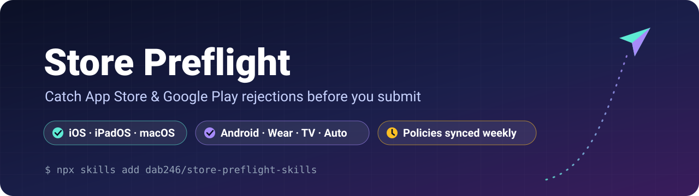
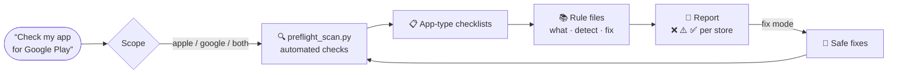
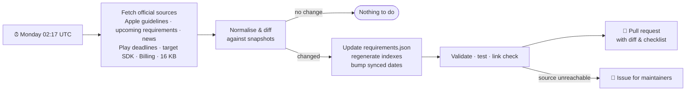

<div align="center">



<h3>An agent skill that reviews your mobile app against <b>Apple App Store</b> and <b>Google Play</b> rules before you hit “Submit”.</h3>

[](https://github.com/dab246/store-preflight-skills/actions/workflows/ci.yml)
[](https://github.com/dab246/store-preflight-skills/actions/workflows/policy-sync.yml)
[](https://github.com/dab246/store-preflight-skills/releases)
[](LICENSE)
<br>
[](https://developer.apple.com/app-store/review/guidelines/)
[](https://developer.android.com/google/play/requirements/target-sdk)
[](#what-gets-checked)
[](CONTRIBUTING.md)
[](https://github.com/dab246/store-preflight-skills/stargazers)

[**Install**](#install) · [**Usage**](#usage) · [**What gets checked**](#what-gets-checked) · [**Weekly policy sync**](#weekly-policy-sync) · [**Contributing**](#contributing) · [**Changelog**](CHANGELOG.md)

</div>

---

## ✨ Why Store Preflight?

A rejection costs days: a new build, a new review queue, a slipped launch. Most rejections are
**predictable** — a missing purpose string, an outdated `targetSdk`, a subscription screen that hides
the billed price, an "Android" in your App Store description.

Store Preflight turns those patterns into **checks your agent runs before you submit**, for one store
or both at once.

| | |
|---|---|
| 🍎 **App Store** | 19 rules · 10 app-type checklists · iOS, iPadOS, macOS |
| 🤖 **Google Play** | 32 rules · 10 app-type checklists · phone, Wear OS, TV, Automotive, XR |
| 🔀 **Flexible scope** | `apple`, `google` or `both`; filter by category; quick scan, full review or fix mode |
| 🔍 **Deterministic scanner** | `preflight_scan.py` — manifests, plists, privacy manifests, Gradle, ELF alignment, metadata limits. Zero dependencies |
| 🧩 **Any stack** | Native, Flutter, React Native / Expo, Capacitor, Kotlin Multiplatform |
| 🛰️ **Always current** | A weekly GitHub Action diffs official Apple & Google sources and opens a PR when anything changes |
| 📎 **Official sources only** | Every rule links to developer.apple.com, developer.android.com or support.google.com |

## 🧭 How it works



1. **Scope** — the agent detects which stores apply (or you tell it) and which app types matter.
2. **Scan** — `scripts/preflight_scan.py` runs every check that doesn't need judgement.
3. **Review** — the agent walks the matching checklists and rule files for everything else.
4. **Report** — findings per store, ordered by severity, with file/line, fix and rule reference.
5. **Fix & re-validate** — optional; safe fixes are applied and the affected checks re-run.

<a id="install"></a>

## 📦 Install

### Requirements

- An AI coding agent that supports **Agent Skills** (a folder with a `SKILL.md` file).
- **Python 3.9+** for the scanner (standard library only — nothing to `pip install`).
- **Git** (for options B and D) or **Node.js 18+** (for option A).

### Option A — one command with `npx skills` (recommended)

```bash
npx skills add dab246/store-preflight-skills
```

Follow the prompts to choose the agent(s) and whether the skill is installed for the current project
or for your user account. Re-run the same command to update to the latest version.

### Option B — clone into your agent's skills folder

Agents load skills from a `skills/` directory — either in your user-level config folder (available in
every project) or inside a project (shared with your team through git). Check your agent's
documentation for the exact location, then:

```bash
# user-level install (all projects)
SKILLS_DIR="$HOME/.<your-agent>/skills"
# …or project-level install (this repository only)
# SKILLS_DIR="./.<your-agent>/skills"

mkdir -p "$SKILLS_DIR"
git clone --depth 1 https://github.com/dab246/store-preflight-skills.git "$SKILLS_DIR/store-preflight-skills"

# update later
git -C "$SKILLS_DIR/store-preflight-skills" pull
```

### Option C — download a release

Every [release](https://github.com/dab246/store-preflight-skills/releases) ships a
`store-preflight-skills-vX.Y.Z.zip`. Unzip it into your agent's skills folder — the archive already
contains the `store-preflight-skills/` directory.

### Option D — git submodule (pin a version for your team)

```bash
git submodule add https://github.com/dab246/store-preflight-skills.git .<your-agent>/skills/store-preflight-skills
git -C .<your-agent>/skills/store-preflight-skills checkout v1.0.0
git commit -m "chore: add store preflight skill"
```

### ✅ Verify the installation

```bash
python3 <skills-dir>/store-preflight-skills/scripts/preflight_scan.py --help
```

Then restart your agent and ask: **“Run a store preflight on this project.”** The agent should
mention the scope it detected and start with the automated scan.

> [!TIP]
> Click **Watch → Custom → Releases** on this repository to be notified when policies change.

<a id="usage"></a>

## 🚀 Usage

Just ask your agent in plain language. Some examples:

| You say | What happens |
|---|---|
| “Run store preflight” | Auto-detects iOS/Android, full review for each store found |
| “Check only Google Play” | Google Play rules and checklists only |
| “Preflight both stores, quick scan” | Automated scanner for both stores, no manual checklist |
| “Apple rejected us for 5.1.1, what's wrong?” | Focuses on `references/apple/rules/privacy/` |
| “Check permissions and privacy for Play” | Scanner with `--only permissions,privacy` + those rule folders |
| “Preflight and fix what you can” | Full review, safe fixes applied, checks re-run |
| “We're adding subscriptions and an AI chat, what do we need?” | Loads subscription + AI checklists for both stores |

### Use the scanner directly (no agent)

```bash
python3 scripts/preflight_scan.py path/to/app                  # auto-detect stores
python3 scripts/preflight_scan.py path/to/app --store google   # one store
python3 scripts/preflight_scan.py path/to/app --store all --only privacy,metadata
python3 scripts/preflight_scan.py path/to/app --metadata ./store-metadata --format json
python3 scripts/preflight_scan.py path/to/app --strict          # exit 2 on any rejection
```

<details>
<summary><b>Example output</b></summary>

```markdown
# Preflight scan (automated checks)

- **Project:** flutter · Android: yes · Apple: yes
- **Stores checked:** 🍎 App Store, 🤖 Google Play

## 🍎 App Store

❌ 2 rejection · ⚠️ 2 warning · ℹ️ 0 info

- ❌ **[5.1.1 / ITMS-91053] Required-reason API used but no PrivacyInfo.xcprivacy** — `ios/Runner/AppDelegate.swift:8`
  - NSPrivacyAccessedAPICategoryUserDefaults usage detected. Uploads without a privacy manifest that declares an approved reason are rejected.
  - Rule: `references/apple/rules/privacy/privacy_manifest.md`
- ❌ **[2.3.10] [en-US] name mentions "Android"** — `metadata/en-US/name.txt`
- ⚠️ **[5.1.1(ii)] NSCameraUsageDescription is vague: "Need camera"** — `ios/Runner/Info.plist`
- ⚠️ **[4.8] Third-party login without Sign in with Apple (or equivalent)** — `lib/auth/login_page.dart:3`

## 🤖 Google Play

❌ 2 rejection · ⚠️ 1 warning · ℹ️ 1 info

- ❌ **[Target API level] targetSdk 34 is below the required API 36** — `android/app/build.gradle.kts:14`
- ❌ **[Play Billing Library] Play Billing Library 7.x is deprecated** — `android/app/build.gradle.kts:22`
- ⚠️ **[Permissions & APIs that access sensitive info] Contacts access: READ_CONTACTS** — `android/app/src/main/AndroidManifest.xml:6`
- ℹ️ **[16 KB page size] Native code is bundled - verify 16 KB alignment of the final AAB**
```

</details>

### Run it in your app's CI

Add this workflow to **your app repository** to block merges that would be rejected:

```yaml
# .github/workflows/store-preflight.yml
name: Store preflight
on: [pull_request]
jobs:
  preflight:
    runs-on: ubuntu-latest
    steps:
      - uses: actions/checkout@v4
      - uses: actions/checkout@v4
        with:
          repository: dab246/store-preflight-skills
          ref: v1.0.0
          path: .store-preflight
      - uses: actions/setup-python@v5
        with:
          python-version: "3.13"
      - name: Scan
        run: |
          python .store-preflight/scripts/preflight_scan.py . --store all --strict | tee -a "$GITHUB_STEP_SUMMARY"
```

### ⚙️ Configuration

Optional `.store-preflight.json` in **your app's** root:

```json
{
  "ai_service_terms": ["<AI brand your app uses>"],
  "ai_endpoints": ["api\\.your-ai-provider\\.example"],
  "ignore": ["google/technical/sixteen_kb_page_size"]
}
```

| Key | Purpose |
|---|---|
| `ai_service_terms` | Brand names of AI services you integrate. Flagged in App Store metadata of **every** locale (China mainland storefront rules). |
| `ai_endpoints` | Extra regexes that identify calls to third-party AI services (consent and reporting checks). Generic API shapes are detected out of the box. |
| `ignore` | Rule paths to suppress once you've reviewed them manually. |

<a id="what-gets-checked"></a>

## 🔎 What gets checked

<details open>
<summary><b>🍎 App Store — 19 rules</b></summary>

| Area | Rule | Guideline | Auto |
|---|---|---|:-:|
| Technical | [Xcode 26 SDK, iOS 13+ deployment target](references/apple/rules/technical/sdk_requirements.md) | Upload | ✅ |
| Privacy | [Privacy manifest & required-reason APIs](references/apple/rules/privacy/privacy_manifest.md) | 5.1.1 · ITMS-91053 | ✅ |
| Privacy | [Missing / vague purpose strings](references/apple/rules/privacy/purpose_strings.md) | 5.1.1(ii) | ✅ |
| Privacy | [App Tracking Transparency mismatches](references/apple/rules/privacy/app_tracking_transparency.md) | 5.1.2 | ✅ |
| Privacy | [Third-party AI consent](references/apple/rules/privacy/third_party_ai_consent.md) | 5.1.2(i) | ◐ |
| Privacy | [Account deletion](references/apple/rules/privacy/account_deletion.md) | 5.1.1(v) | ◐ |
| Privacy | [Unnecessary personal data](references/apple/rules/privacy/unnecessary_data.md) | 5.1.1 | — |
| Metadata | [Limits & accuracy, screenshots, previews](references/apple/rules/metadata/accurate_metadata.md) | 2.3 | ◐ |
| Metadata | [Creative assets](references/apple/rules/metadata/creative_assets.md) | 2.3.14 | — |
| Metadata | [Other platforms & brands](references/apple/rules/metadata/competitor_terms.md) | 2.3.10 | ✅ |
| Metadata | [China mainland storefront & AI services](references/apple/rules/metadata/china_storefront.md) | 5 | ◐ |
| Metadata | [Review notes & demo account](references/apple/rules/metadata/review_notes.md) | 2.1 | — |
| Design | [Sign in with Apple / login services](references/apple/rules/design/sign_in_with_apple.md) | 4.8 | ◐ |
| Design | [Hidden & review-dependent features](references/apple/rules/design/hidden_features.md) | 2.5.19 | ◐ |
| Design | [Minimum functionality & spam](references/apple/rules/design/minimum_functionality.md) | 4.2 · 4.3 | — |
| Design | [UGC & AI-generated content safeguards](references/apple/rules/design/user_generated_content.md) | 1.2 | — |
| Payments | [Digital goods outside IAP](references/apple/rules/subscription/in_app_purchase.md) | 3.1.1 | ◐ |
| Payments | [Subscription disclosure & pricing](references/apple/rules/subscription/subscription_disclosure.md) | 3.1.2 | — |
| Entitlements | [Unused entitlements & Mac sandbox](references/apple/rules/entitlements/unused_entitlements.md) | 2.4.5(i) | ✅ |

</details>

<details open>
<summary><b>🤖 Google Play — 32 rules</b></summary>

| Area | Rules | Auto |
|---|---|:-:|
| Technical | [Target API 36](references/google/rules/technical/target_api_level.md) · [Billing Library 8](references/google/rules/technical/play_billing_library_version.md) · [16 KB page size](references/google/rules/technical/sixteen_kb_page_size.md) · [AAB, signing, debuggable](references/google/rules/technical/app_bundle_and_signing.md) | ✅ |
| Permissions | [SMS & Call Log](references/google/rules/permissions/sms_call_log.md) · [All files access](references/google/rules/permissions/all_files_access.md) · [QUERY_ALL_PACKAGES](references/google/rules/permissions/query_all_packages.md) · [Install packages](references/google/rules/permissions/request_install_packages.md) · [Location](references/google/rules/permissions/location.md) · [Contacts](references/google/rules/permissions/contacts.md) · [Photo & video](references/google/rules/permissions/photo_video.md) · [Exact alarms](references/google/rules/permissions/exact_alarm.md) · [Full-screen intents](references/google/rules/permissions/full_screen_intent.md) · [Accessibility API](references/google/rules/permissions/accessibility_api.md) · [Foreground services & VPN](references/google/rules/permissions/foreground_service_and_vpn.md) · [Health Connect](references/google/rules/permissions/health_connect.md) | ✅ |
| Privacy | [Data safety form](references/google/rules/privacy/data_safety_form.md) · [Account deletion](references/google/rules/privacy/account_deletion.md) · [Prominent disclosure](references/google/rules/privacy/prominent_disclosure.md) | ◐ |
| Metadata | [Store listing limits & metadata policy](references/google/rules/metadata/store_listing.md) | ✅ |
| Monetization | [Play Billing](references/google/rules/monetization/play_billing.md) · [Subscriptions](references/google/rules/monetization/subscriptions.md) · [Ads](references/google/rules/monetization/ads.md) | ◐ |
| Content | [AI-generated content](references/google/rules/content/ai_generated_content.md) · [UGC](references/google/rules/content/user_generated_content.md) · [Anonymous chat](references/google/rules/content/anonymous_chat.md) · [Families](references/google/rules/content/families_policy.md) · [Financial services](references/google/rules/content/financial_services.md) · [Minimum functionality & spam](references/google/rules/content/minimum_functionality_spam.md) | ◐ |
| Account | [12 testers × 14 days](references/google/rules/account/closed_testing_requirement.md) · [Developer verification](references/google/rules/account/developer_verification.md) · [App access for reviewers](references/google/rules/account/app_access_review.md) | — |

</details>

✅ automated by the scanner · ◐ partly automated · — reviewed by the agent from the checklist

**App-type checklists:** subscriptions/IAP · social & UGC · kids/families · health & fitness · games ·
AI · finance/crypto/loans · VPN · macOS · Wear/TV/Auto — see
[`references/apple/checklists`](references/apple/checklists) and
[`references/google/checklists`](references/google/checklists).
Both-store reviews use the [cross-store matrix](references/shared/cross_store_matrix.md).

<a id="weekly-policy-sync"></a>

## 🛰️ Weekly policy sync

Store rules change constantly. Every Monday a GitHub Action keeps the skill current:



- **Exact diffs:** the Apple extractor reports which guideline numbers were added, changed or removed.
- **Machine-readable thresholds** (`targetSdk`, Billing Library, Xcode/SDK, deployment target, 16 KB
  dates) are parsed and written to `references/*/requirements.json`, which the scanner reads — so
  most deadline changes need no code change.
- **Generated indexes:** [`live-index.md`](references/apple/guidelines/live-index.md) (every Apple
  guideline) and [`upcoming-deadlines.md`](references/google/policies/upcoming-deadlines.md) (Play
  timeline).
- **Human in the loop:** changes land as a pull request labelled `policy-update`; maintainers update
  rule text and the changelog before merging.

<details>
<summary><b>Maintainer setup (one time)</b></summary>

1. **Settings → Actions → General → Workflow permissions:** select *Read and write permissions* and
   tick *Allow GitHub Actions to create and approve pull requests*
   ([docs](https://docs.github.com/en/repositories/managing-your-repositorys-settings-and-features/enabling-features-for-your-repository/managing-github-actions-settings-for-a-repository)).
2. **Settings → Secrets and variables → Actions → New repository secret:** `BLOCKED_TERMS` — a
   comma-separated list of words that must never appear in the repository. The sync masks them in
   snapshots and the content guard fails CI if they appear in files, commit messages, branch names or
   PR text. The list itself is never committed.
3. Run **Actions → Weekly policy sync → Run workflow** once to confirm everything works.

</details>

## 🗂️ Project structure

```text
store-preflight-skills/
├── SKILL.md                     # agent instructions (scope → scan → checklists → rules → report)
├── scripts/
│   ├── preflight_scan.py        # deterministic scanner (stdlib only)
│   ├── validate_rules.py        # knowledge-base validator (CI)
│   ├── content_guard.py         # blocked-terms guard (CI)
│   ├── check_links.py           # official-link checker (weekly)
│   └── sync/                    # weekly policy sync: sources.json + sync_sources.py
├── references/
│   ├── apple/   requirements.json · guidelines/ · checklists/ · rules/{technical,privacy,metadata,design,subscription,entitlements}
│   ├── google/  requirements.json · policies/ · checklists/ · rules/{technical,permissions,privacy,metadata,monetization,content,account}
│   └── shared/  cross_store_matrix.md · report_template.md
├── sources/snapshots/           # normalised copies of official pages (diff baseline)
└── tests/                       # unit tests + fixtures (android-app, ios-app, clean-android)
```

<a id="contributing"></a>

## 🤝 Contributing

Contributions of all sizes are welcome — and **rejection stories are gold**.

- 🚫 Got rejected? [Share it](https://github.com/dab246/store-preflight-skills/issues/new?template=rejection_report.yml) (anonymised) so it becomes a rule.
- 📚 Know a policy that isn't covered? [Request a rule](https://github.com/dab246/store-preflight-skills/issues/new?template=rule_request.yml).
- 🔍 Scanner false positive? [Report a bug](https://github.com/dab246/store-preflight-skills/issues/new?template=bug_report.yml).
- 🛠️ Ready to code? Read [CONTRIBUTING.md](CONTRIBUTING.md) — adding a rule is a single Markdown file.

Look for issues labelled [`good first issue`](https://github.com/dab246/store-preflight-skills/labels/good%20first%20issue).

## ❓ FAQ

<details>
<summary><b>Does my code leave my machine?</b></summary>

No. The scanner runs locally and only reads files. Your agent reads the files it needs, as it would for
any other task.
</details>

<details>
<summary><b>Does a clean report guarantee approval?</b></summary>

No. Review is done by people applying guidelines to your specific app. The skill catches the
predictable problems so reviewers only see the interesting ones.
</details>

<details>
<summary><b>How fresh are the rules?</b></summary>

Machine-readable thresholds and indexes are refreshed weekly by the policy sync. Each rule's
`last_verified` date shows when its text was last checked against the official source.
</details>

<details>
<summary><b>Can I use it without an agent?</b></summary>

Yes — run `scripts/preflight_scan.py` directly or in CI, and use the checklists as a manual review guide.
</details>

## ⚖️ Disclaimer

This project is community-maintained and is **not affiliated with, endorsed by, or sponsored by Apple
Inc. or Google LLC**. App Store, iOS, iPadOS and macOS are trademarks of Apple Inc. Google Play and
Android are trademarks of Google LLC. Always treat the official
[App Store Review Guidelines](https://developer.apple.com/app-store/review/guidelines/) and
[Google Play Policy Center](https://play.google/developer-content-policy/) as the source of truth.

## 📄 License

[MIT](LICENSE) © dab246

<div align="center">

**If Store Preflight saved you a rejection, consider giving it a ⭐ — it helps others find it.**

</div>
